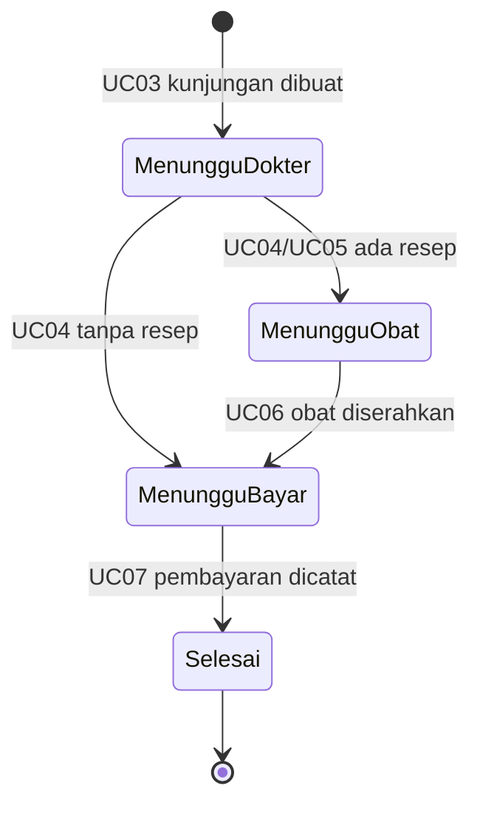

# Use Case SiKlinik

> Sumber: Laporan Akhir ASP Kelompok 5, **Bab IV.1** (Tabel 4.1), aturan bisnis **Bab III.4**, dan keterkaitan ke use case umum **Bab V (Tabel 5.2)**.
> Penyusun artefak: Hakim (System Analyst & UI/UX). Peninjau: Raihan.

## 1. Diagram Use Case per Aktor

Satu diagram untuk tiap aktor, menunjukkan apa saja yang dikerjakan aktor itu di SiKlinik. Isi aktivitas diturunkan dari BPMN to-be (Bab III.2 dan III.3), aturan bisnis (Tabel 3.2), kriteria penerimaan user story (Tabel 4.2), dan prototipe web (22 layar). Detail layar seperti tombol, field, dan fitur di luar MVP sengaja tidak digambar.

Catatan notasi: `«include»` = langkah yang selalu ikut dijalankan; `«extend»` = langkah tambahan yang hanya terjadi pada kondisi tertentu. Relasi ini disusun tim dari alur dan aturan bisnis, tidak tertulis eksplisit di laporan. Login (UC01) dipakai semua aktor sehingga diulang di tiap diagram; keterkaitannya ditunjukkan lewat `«include»` dari tiap aktivitas utama, dan semua garis relasi berada di dalam kotak sistem.

### 1.1 Pendaftaran (UC02, UC03)

- Melihat antrean hari ini dan jadwal dokter.
- Mencari pasien lewat nama, NIK, atau nomor RM.
- Jika tidak ditemukan, mendaftarkan pasien baru; sistem mengecek duplikat (NIK atau nama + tanggal lahir) dan menerbitkan nomor RM bila pasien benar-benar baru (BR01–BR03).
- Mendaftarkan kunjungan: memilih dokter dan jenis (onsite/online); sistem membuat nomor antrean harian dengan status Menunggu dokter (BR04).

### 1.2 Dokter (UC04, UC05)

- Melihat daftar pasien yang antre untuk dokter tersebut dan jadwal dokter.
- Mengisi rekam medis (keluhan dan diagnosis wajib), melihat riwayat pasien, dan memilih layanan; pembukaan dan pembuatan rekam medis tercatat di log akses (BR05).
- Bila perlu obat, membuat e-resep (obat, jumlah, aturan pakai). Tanpa resep, kunjungan langsung Menunggu bayar (BR06).

### 1.3 Apoteker (UC06)

- Melihat resep masuk.
- Menyerahkan obat: sistem mengecek stok seluruh item lalu memotong stok per batch. Bila stok salah satu item kurang, penyerahan ditolak (BR07).
- Mengelola stok obat: mencatat stok masuk (nomor batch dan tanggal kedaluwarsa) dan melihat peringatan stok (F06).

### 1.4 Kasir (UC07)

- Melihat tagihan otomatis (layanan + obat).
- Menerima pembayaran dengan memilih metode pembayaran. Pembayaran tunai menampilkan kembalian, dan struk dicetak bersama pencatatan pembayaran (BR08, BR09).
- Melihat daftar struk hari ini untuk membuka dan mencetak ulang.

### 1.5 Manajer (UC08, UC09, UC10)

- Melihat dashboard dan mengunduh laporan bulanan.
- Mengelola akun, layanan dan tarif, serta jadwal dokter.
- Melihat log akses: siapa, kapan, dan objek yang diakses.

### 1.6 Tim SiKlinik (UC11, UC12)

- Mengelola klinik pelanggan (termasuk menambah klinik baru), paket, dan tagihan langganan (menandai lunas).
- Mengimpor data pasien dari CSV ke klinik tujuan (menu tersendiri).

> Sumber diagram: berkas `.dot` di folder `img/` (Graphviz). Edit lalu render ulang dengan `dot -Tpng -Gdpi=170 nama.dot -o nama.png`.

## 2. Daftar Use Case

| ID | Use case | Aktor | Hasil | Use case umum (Bab V) |
| --- | --- | --- | --- | --- |
| UC01 | Masuk (kode klinik, username, kata sandi, MFA) | Semua aktor | Sesi dan menu sesuai peran | UP11 |
| UC02 | Cari dan daftarkan pasien (MPI) | Pendaftaran | Data pasien unik dengan nomor RM | UP01 |
| UC03 | Daftarkan kunjungan dan antrean | Pendaftaran | Kunjungan dengan nomor antrean | UP01 |
| UC04 | Isi rekam medis dan layanan | Dokter | Rekam medis tersimpan, akses tercatat | UP03, UP07 |
| UC05 | Buat e-resep | Dokter | Resep masuk ke apotek | UP04 |
| UC06 | Serahkan obat dan kelola stok | Apoteker | Stok berkurang, status Menunggu bayar | UP05, UP06 |
| UC07 | Terima pembayaran dan cetak struk | Kasir | Status Selesai, struk tercetak | UP07 |
| UC08 | Dashboard dan laporan bulanan | Manajer | Ringkasan dan berkas laporan | UP09 |
| UC09 | Kelola akun, layanan, tarif, jadwal | Manajer | Data master terkelola | UP02, UP08, UP12 |
| UC10 | Lihat log akses | Manajer | Jejak aktivitas dan akses rekam medis | UP13 |
| UC11 | Kelola klinik, paket, langganan | Tim SiKlinik | Klinik pelanggan terkelola | UP14, UP15, UP16 |
| UC12 | Impor data pasien (CSV) | Tim SiKlinik | Data awal pasien termuat | UP14 |

## 3. Spesifikasi Use Case Alur Utama

Alur diturunkan dari BPMN to-be (Bab III.2 dan III.3) dan aturan bisnis BR01 sampai BR10.

### UC02 Cari dan daftarkan pasien (MPI)

| Elemen | Isi |
| --- | --- |
| Aktor | Pendaftaran |
| Prasyarat | Sudah login (UC01) |
| Alur utama | 1. Petugas mencari pasien lewat nama, NIK, atau nomor RM. 2. Jika tidak ditemukan, petugas mengisi data pasien baru. 3. Sistem memeriksa duplikat berdasarkan NIK atau kombinasi nama + tanggal lahir. 4. Jika belum ada, sistem menerbitkan nomor RM baru. |
| Alur alternatif | Pasien sudah ada: sistem memakai data lama dan menampilkan pesan, tidak membuat pasien baru. |
| Pascakondisi | Data pasien unik tersimpan dengan nomor RM |
| Aturan bisnis | BR01, BR02, BR03 |

### UC03 Daftarkan kunjungan dan antrean

| Elemen | Isi |
| --- | --- |
| Aktor | Pendaftaran |
| Prasyarat | Data pasien tersedia (UC02) |
| Alur utama | 1. Petugas memilih dokter dan jenis pendaftaran (onsite atau online). 2. Sistem membuat kunjungan dengan nomor antrean harian. |
| Pascakondisi | Kunjungan berstatus **Menunggu dokter** dan muncul di daftar pasien dokter tujuan |
| Aturan bisnis | BR04 |

### UC04 Isi rekam medis dan layanan

| Elemen | Isi |
| --- | --- |
| Aktor | Dokter |
| Prasyarat | Kunjungan berstatus Menunggu dokter |
| Alur utama | 1. Dokter membuka pasien dan melihat riwayat. 2. Dokter mengisi keluhan dan diagnosis. 3. Dokter memilih layanan. 4. Sistem menyimpan rekam medis dan mencatat log akses. |
| Alur alternatif | Peran selain dokter tidak dapat melihat isi rekam medis (ditolak dan tercatat). |
| Pascakondisi | Rekam medis tersimpan, tagihan terbentuk dari layanan terpilih |
| Aturan bisnis | BR05, BR08 |

### UC05 Buat e-resep

| Elemen | Isi |
| --- | --- |
| Aktor | Dokter |
| Prasyarat | Rekam medis sedang diisi (UC04) |
| Alur utama | 1. Dokter memilih obat, jumlah, dan aturan pakai. 2. Sistem menyimpan resep dan mengirimkannya ke apotek. |
| Alur alternatif | Tanpa resep: kunjungan langsung **Menunggu bayar**. |
| Pascakondisi | Dengan resep: status **Menunggu obat** |
| Aturan bisnis | BR06 |

### UC06 Serahkan obat dan kelola stok

| Elemen | Isi |
| --- | --- |
| Aktor | Apoteker |
| Prasyarat | Resep berstatus Menunggu obat |
| Alur utama | 1. Apoteker membuka resep masuk. 2. Sistem mengecek stok seluruh item. 3. Jika cukup, sistem memotong stok per batch dan mencatat penyerahan. |
| Alur alternatif | Stok salah satu item kurang: penyerahan ditolak. |
| Pascakondisi | Stok berkurang, status **Menunggu bayar** |
| Aturan bisnis | BR07 |

### UC07 Terima pembayaran dan cetak struk

| Elemen | Isi |
| --- | --- |
| Aktor | Kasir |
| Prasyarat | Status Menunggu bayar |
| Alur utama | 1. Kasir membuka tagihan (layanan + obat). 2. Kasir memilih metode (Tunai, Transfer, QRIS, Kartu). 3. Sistem mencatat pembayaran, mengubah status menjadi Selesai. 4. Struk dapat dicetak. |
| Alur alternatif | Tunai: layar menampilkan kembalian (tidak disimpan). Tagihan boleh dilunasi lewat lebih dari satu pembayaran. |
| Pascakondisi | Status **Selesai**, struk tercetak |
| Aturan bisnis | BR08, BR09 |

## 4. Status Kunjungan

## 5. Catatan

- UC01 sampai UC12 menggambarkan fitur aplikasi `siklinik-app` yang sudah berjalan.
- Use case umum platform (UP01 sampai UP16, Bab V) dipakai sebagai dasar ERD. Integrasi BPJS/SATUSEHAT (UP10) belum diimplementasikan (F11, Won't).
